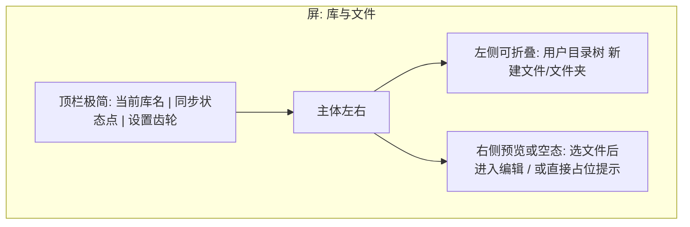
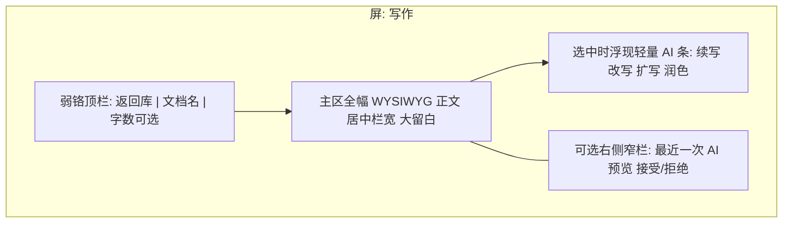
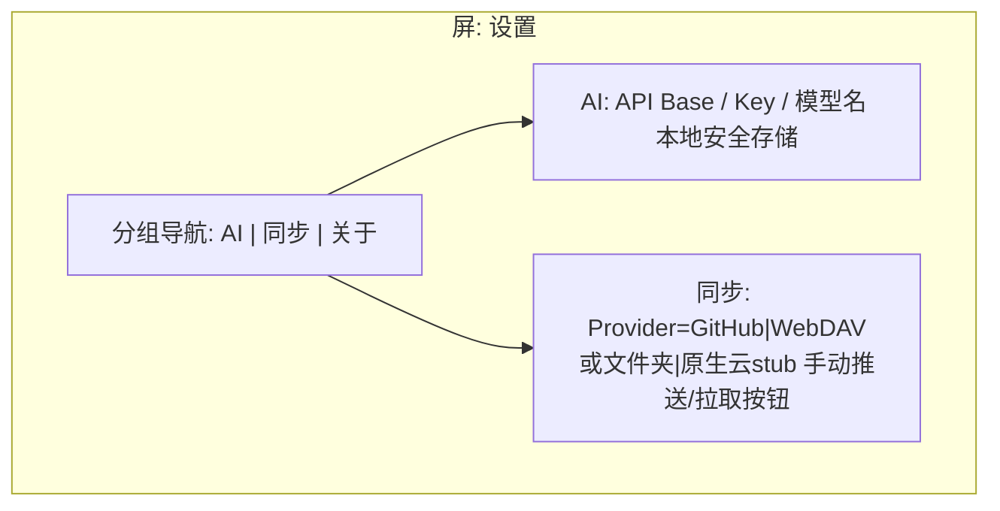
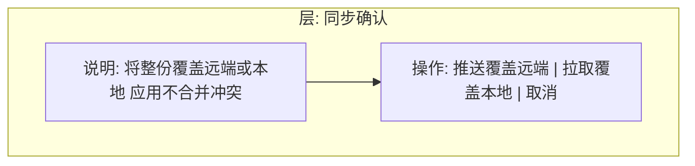

# 产品原型：AI Writer MVP

- **功能**：AI Writer 跨平台写作客户端（MVP）
- **来源**：Agent 生成
- **介质**：Mermaid 线框（无位图）
- **关联 PRD**：`../prd_ai_writer_mvp.md`
- **视觉对标**：iA Writer（极简、大编辑区、弱工具铬）
- **状态**：APPROVED（随 PRD 冻结 · 2026-10-10）

---

## 1. 范围与非目标

- **范围**：首次进入选工作目录、目录浏览、WYSIWYG 写作、AI 建议预览、设置（API Key / 同步 Provider）、手动推送拉取。
- **非目标**：冲突合并 UI、全屏聊天、团队空间、原生云真后端、多级标签体系。

---

## 2. 主路径（成功）

1. 打开应用（免登录）→ 指定/确认工作目录  
2. 在目录树中新建或打开文档  
3. WYSIWYG 写作并本地自动/手动保存  
4. 选中段落 → AI 改写 → 预览 → 接受写回  
5. （可选）设置中配置 GitHub 或 WebDAV/文件夹 → 手动推送；另一端拉取后继续写  

---

## 3. 屏布局（线框）

### 3.1 工作目录 / 文件浏览（偏左窄栏，可隐藏）

关键控件：选择/更换工作目录；树节点打开 `.md`；新建文档。

### 3.2 写作主屏（iA Writer 气质：编辑区绝对主导）

关键控件：正文输入；AI 条；接受/拒绝；无选中时续写作用于光标后。

### 3.3 设置

原生云 stub：可切换，提示「商业化未启用」；选择真启用时才走注册/登录（MVP stub 可不接通）。

### 3.4 同步操作（覆盖确认，无冲突 UI）

---

## 4. 与 PRD / DoD 映射

| 原型节点 | 用例 / DoD |
|----------|------------|
| 指定工作目录 + 目录树 | UC_001 / 用户指定组织 |
| WYSIWYG 主屏 | UC_001, UC_003 |
| AI 条 + 接受/拒绝 | UC_002 |
| 设置 AI Key | DoD API Key |
| GitHub / WebDAV 推拉 | UC_004 |
| 原生云 stub | UC_005 |
| 同步覆盖确认 | 冲突不处理规则 |
| 免登录进入 | UC_006 |
