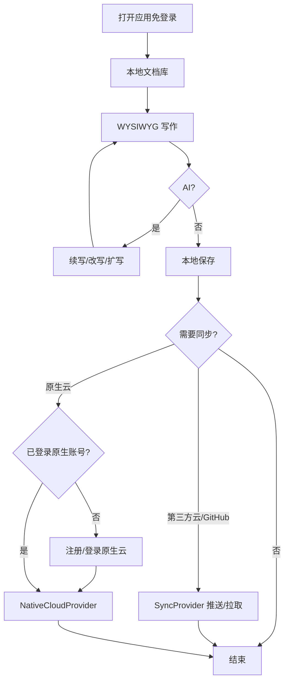

# 产品需求规格说明书 (PRD)：AI Writer MVP

- **需求名称**：AI Writer 跨平台写作客户端（MVP）
- **创建时间**：2026-10-10
- **状态**：APPROVED（阶段 0 已冻结 · 2026-10-10）
- **负责人**：hardstone
- **元数据**：`change_size=L` · `work_mode=IMPLEMENT` · 生命周期阶段 4～5（任务拆分 + 垂直切片实现）

---

## 0. 冻结进度（审讯结论）

| 决策点 | 状态 | 结论 |
|---|---|---|
| 核心用户 | **已定** | 个人创作者（博客 / 公众号 / 小说 / 文案） |
| 核心场景 | **已定** | 从空白或大纲出发，AI 协助写出一篇完整长文并保存 |
| 多端范围 | **已定** | MVP **直接覆盖五端**：Windows / Linux / macOS / iOS / Android |
| AI 模型供应 | **已定** | 用户自备 API Key；OpenAI 兼容 Chat API；失败仍可本地写作 |
| 非目标 | **已定** | 不做实时协作、不做团队空间、不做纯聊天主界面；知识库/RAG 二期；不做内置模型计费 |
| 跨设备同步 | **已定** | 支持**云存储、GitHub 等第三方同步**；同时**预留本项目原生云端同步接口**供日后商业化 |
| 账号模型 | **已定** | **默认免注册**；仅在使用**原生云端同步（商业化路径）**时要求注册/登录 |
| 编辑体验 | **已定** | **富文本 + Markdown、所见即所得（WYSIWYG）**；用户精力聚焦写作本身（底层可存 Markdown，交互不以源码为主） |
| 第三方同步 MVP 名单 | **已定** | **GitHub**（仓库/目录）+ **通用 WebDAV 或本地同步文件夹**（可挂 OneDrive/坚果云等）；各厂官方 SDK（Drive/iCloud 等）二期 |
| 同步触发 | **已定** | **手动推送/拉取为主** + 可选打开时检查更新 |
| 冲突策略 | **已定** | **项目不处理冲突**：无冲突检测 UI、无冲突副本、无自动合并；推/拉为整份覆盖语义，不一致由用户自选方向或在外部（Git/云盘）解决 |
| 原生云 MVP 边界 | **已定** | 统一 `SyncProvider` 契约 + 原生云 stub（可切换，提示未启用）；不建账号服务器与计费 |
| AI 在 WYSIWYG 内的交互 | **已定** | 选中 → 续写/改写/扩写/润色 → 预览 → 接受/拒绝写回；无选中则光标后续写；无独立全屏聊天，最多侧栏最近一次结果 |
| 文档组织 | **已定** | **由用户指定**：用户选择工作目录/库根；目录层级即用户文件系统（或同步目录）结构；应用不强加笔记本/标签树 |
| 视觉气质 | **已定** | **参考 iA Writer**：安静、极简、大编辑区、弱工具铬、专注长文 |
| MVP 成功标准 | **已定** | 见 §5 DoD |
| UI 主路径原型 | **已产** | `_03_product_figma/ai_writer_mvp_prototype.md`（待你确认后冻结） |

---

## 1. 业务背景与用户痛点

个人创作者需要在本地专注写作，并在写稿过程中随时调用 AI；草稿常跨手机与电脑。本产品以**本地优先的写作客户端**为主，AI 嵌入编辑器；跨设备通过**用户自有云存储 / GitHub** 同步，并为日后**原生云端商业化**预留同一套同步抽象，避免日后推倒重来。

---

## 2. 用户画像与核心用例

**画像**：个人创作者；默认无账号；可选用自有云或（未来）原生云同步多端。

| 用例 ID | 角色 | 触发动作 | 预期结果 |
|---|---|---|---|
| `UC_001` | 创作者 | 指定工作目录后新建/打开文档并在 WYSIWYG 中写作 | 所见即所得；落在用户指定目录树中；可含 Markdown 语义 |
| `UC_002` | 创作者 | 选中范围请求 AI 续写/改写/扩写 | 建议可接受/拒绝并写回文档 |
| `UC_003` | 创作者 | 本地保存 / 再打开 | 内容与格式一致恢复 |
| `UC_004` | 创作者 | 配置 GitHub 或 WebDAV/同步文件夹并手动推送/拉取 | 目标端出现覆盖后的文档并可继续编辑；应用不做冲突合并 |
| `UC_005` | 创作者 | 尝试原生云端同步 | MVP：走统一同步接口；未商业化时可提示未启用或走 stub；启用后才要求注册/登录 |
| `UC_006` | 创作者 | 仅本地使用，不配置任何同步 | 免注册完整可用（写作 + AI Key + 本地存取） |

---

## 3. 详细功能流程与业务规则

### 业务规则（已定）
1. 主路径：**WYSIWYG 写作 + AI 辅助 + 本地存取**；不是聊天机器人。
2. **五端同发**，能力集对齐。
3. AI：用户自备 Key（OpenAI 兼容）；失败不锁死编辑器。
4. **同步 Provider**：MVP = **GitHub** + **WebDAV/同步文件夹**；另含 **原生云 stub**（同一 `SyncProvider` 抽象）。
5. **同步触发**：手动推送/拉取为主；可可选「打开时检查更新」。
6. **冲突**：**应用不处理**——不检测、不合并、不生成冲突副本；推/拉按用户选择做整份覆盖；其余交给用户或外部工具。
7. **账号**：默认免注册；仅原生云（未来真后端）要注册/登录。第三方用各厂商 OAuth/Token。
8. **编辑器**：富文本 + Markdown 语义的 WYSIWYG。
9. **不做**：实时协作、团队空间、纯聊天主界面、知识库/RAG、内置模型计费、冲突解决 UI。

### 业务规则（补充已定）
10. **AI 交互**：选中 → 续写/改写/扩写/润色 → 预览 → 接受/拒绝；无选中则光标后续写；无独立全屏聊天。
11. **文档组织**：**用户指定**工作目录/库根；文件夹层级即用户组织方式；应用不强制笔记本/标签树。
12. **视觉**：气质对齐 **iA Writer**（极简、大编辑区、弱铬、专注写作）。

---

## 4. 非功能性需求 (NFR)（草案）

- **平台**：Win / Linux / macOS / iOS / Android 均可完成主路径。
- **数据**：本地权威副本；同步为显式或可配置的 Provider 行为。
- **可扩展**：同步必须经统一 `SyncProvider`（或等价）接口；新增原生云不得改写编辑器核心。
- **可用性**：无同步、无 AI 时，本地写作仍完整可用。
- **安全**：API Key 与第三方 Token 存系统安全存储（各端 Keychain/Credential 等）；原生账号凭证同理。

---

## 5. 验收标准与完成定义 (DoD)（部分冻结）

- [ ] 五端：在用户指定工作目录内 WYSIWYG 新建/编辑/本地保存/再打开一致。
- [ ] 五端：AI 续写或改写至少一种，预览后可接受写回。
- [ ] AI 不可用时本地写作仍可用。
- [ ] 可配置并保存用户 API Key。
- [ ] GitHub 或 WebDAV/同步文件夹至少一种：两端间手动推送与拉取成功（整份覆盖）。
- [ ] 无冲突合并/冲突副本 UI；覆盖方向由用户显式选择。
- [ ] 原生云：`SyncProvider` 契约 + stub 可切换；未启用不影响免登录本地使用。
- [ ] 未登录可完整使用本地 + 第三方同步。
- [ ] UI 气质可辨识为 iA Writer 方向（大编辑区、弱铬、极简），见原型。

---

## 6. 非目标（已定）

- 实时多人协作编辑
- 团队 / 组织空间与权限体系
- 以聊天机器人为主界面
- 知识库 / 多文档 RAG（二期）
- 内置模型配额计费（MVP 用户自备 Key）
- MVP 上线完整商业化原生云后端（仅契约 + stub）
- 应用内冲突检测 / 合并 / 冲突副本
