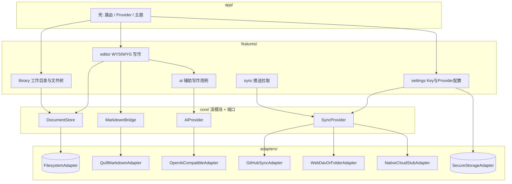

# 架构设计文档：AI Writer

- **产品/域名称**：AI Writer
- **产品类型 / 规模**：写作工具客户端 / 小
- **选定范式**：核心 B2 + 集成端口 B3 局部 · 前端 F2（见 ADR-002）
- **架构模式**：模块化客户端 + Hexagonal 端口（AI / Sync）· Feature 模块
- **指导详规**：`dev_paradigm` → `frontend_arch` · `deep_modules`
- **技术栈**：Flutter + flutter_quill（ADR-001）
- **更新日期**：2026-10-10
- **状态**：APPROVED（阶段 2 冻结 · 2026-10-10）

---

## 0. 范式选型（必填）

| 项 | 值 |
|----|-----|
| 复杂度信号 | 五端 UI；Markdown 文件权威；多 Sync/AI 适配器；无实时协作 |
| 后端/核心阶 | B2 用例层 + 模块化；对 AI/Sync 用端口（B3 局部） |
| 前端阶 | F2 — 按业务 Feature |
| 为何不升级 | 无多团队/多模型冲突，不上 DDD/FSD/微服务 |
| 为何不降级 | Sync/AI 必须可替换（≥2 Adapter），需真 seam |

---

## 1b. 业务模块图（非 DDD）



| 模块 | 职责 | 依赖 | 数据归属 |
|------|------|------|----------|
| `library` | 选择/记住工作目录；目录树；新建/打开/删除文件 | DocumentStore | 无自有库；视图状态 |
| `editor` | WYSIWYG；保存；唤起 AI 条 | DocumentStore, MarkdownBridge, ai feature | 当前文档编辑态 |
| `ai` | 续写/改写/扩写/润色用例；预览接受/拒绝 | AiProvider | 最近一次建议（内存） |
| `sync` | 手动推/拉；覆盖确认文案 | SyncProvider, DocumentStore | 同步配置引用 |
| `settings` | API Base/Key/模型；Provider 选择 | SecureStorage, SyncProvider 注册表 | 本地偏好与密钥 |
| `DocumentStore` | 相对库根读写文档；列表 | FilesystemAdapter | **用户工作目录内文件** |
| `MarkdownBridge` | Delta ↔ Markdown 保真编解码 | QuillMarkdownAdapter | 无 |
| `AiProvider` | 补全/改写请求 | OpenAI 兼容 Adapter | 无 |
| `SyncProvider` | push/pull 整文档或整树约定 | GitHub / WebDAV|Folder / Native stub | 远端由各 Adapter 定义 |

依赖规则：`features/*` 互不深入内部；只经 `core` 端口与 `shared` UI。`adapters` 不反向依赖 `features`。

---

## 2. 统一语言（摘录）

| 术语 | 定义 | 禁止别名 | 模块 |
|------|------|----------|------|
| 工作目录 / library_root | 用户指定的文档库根 | 「工作区/仓库」混称云账号 | library |
| 文档 | 库根下的一篇写作文件（权威为 Markdown 文本） | 帖子/笔记（对外文案除外） | DocumentStore |
| 同步提供者 | SyncProvider 实现 | 「网盘账号」= 产品账号 | sync |
| 原生云端 | 商业化 Sync 适配器；唯一需登录路径 | 与 GitHub 登录混为一谈 | NativeCloudStub |
| AI 辅助 | 对选区或光标后的生成建议 | 聊天会话 | ai |

完整词典：`_00_project/_02_project_word.dict.yaml`。

---

## 3. 分层与职责

```text
features/*/ui          → 页面与控件（无 I/O 细节）
features/*/application → 用例编排（打开文档、AcceptAi、PushSync）
core/*                 → 深模块接口（DocumentStore / AiProvider / SyncProvider / MarkdownBridge）
adapters/*             → 文件系统、Quill↔MD、HTTP、GitHub、WebDAV、Native stub、SecureStorage
```

依赖只向内（ui → application → core ← adapters）。

---

## 4. 核心实体与不变量（非 DDD 简表）

| 名称 | 角色 | 身份/键 | 不变量 |
|------|------|---------|--------|
| LibraryRoot | 配置 | 绝对路径 | 必须用户显式选择或确认；可持久记住 |
| Document | 实体 | 相对 library_root 的路径 | 磁盘权威为 UTF-8 Markdown；编辑器态经 MarkdownBridge 同步 |
| AiSuggestion | VO | 一次请求 | 未 Accept 不得写盘 |
| SyncRemoteRef | VO | providerId + remote 定位 | push/pull 整份覆盖；**无冲突合并** |
| ApiCredentials | 密钥 | provider 作用域 | 仅存 SecureStorage |

---

## 5. 关键 Seam（深模块）

| Seam | Interface（小） | Adapters（≥2） | 测试面 |
|------|-----------------|----------------|--------|
| DocumentStore | `list` / `read` / `write` / `create` / `delete` | Filesystem；Memory（测） | 路径穿越拒绝；读写往返 |
| MarkdownBridge | `toMarkdown` / `fromMarkdown` | Quill 实现；固定夹具 | 标题/列表/粗斜体往返 |
| AiProvider | `complete(prompt, selection, mode)` | OpenAI 兼容；Fake | 失败不抛进编辑器致命；可 Accept |
| SyncProvider | `push` / `pull` / `status`（可选） | GitHub；WebDAV/Folder；Native stub；Fake | 覆盖语义；stub 不要求登录 |

**NativeCloudStub**：实现同一 SyncProvider；`push/pull` 返回「未启用」或内存回环；未来真后端只加 Adapter + 登录门闩，不改 editor。

---

## 6. 前端 Feature 映射（F2）

```text
lib/
  app/                 # MaterialApp、主题(DESIGN.md)、路由、Riverpod
  features/
    library/
    editor/
    ai/
    sync/
    settings/
  core/
    document/
    markdown/
    ai_port/
    sync_port/
  adapters/
  shared/              # 间距、极简控件、对话框
```

- 写作主屏 = `editor` + 轻量调用 `ai`  
- 库浏览 = `library`（可折叠侧栏）  
- 设置 = `settings`；同步动作入口可在 settings 或 library 顶栏弱铬  

---

## 7. 跨切与安全

- **无默认账号**：启动不挡登录；仅当选用原生云真适配器时出现注册/登录（MVP stub 不启用）。  
- **密钥**：API Key / GitHub token / WebDAV 密码 → SecureStorage。  
- **同步**：每次推/拉显式确认「将整份覆盖」；无冲突 UI。  
- **AI 失败**：错误 toast/行内提示；编辑器可继续。  
- **路径安全**：所有文件操作限制在 library_root 内。

---

## 8. 与 PRD / 原型追溯

| 架构点 | PRD / 原型 |
|--------|------------|
| 五端单码基 Flutter | 多端范围 |
| DocumentStore + 用户目录 | 文档组织由用户指定 |
| AiProvider + 预览接受 | UC_002 / 原型 AI 条 |
| SyncProvider 三真一 stub | UC_004/005；冲突不处理 |
| DESIGN.md iA 气质 | 视觉已定 + 原型主屏 |
